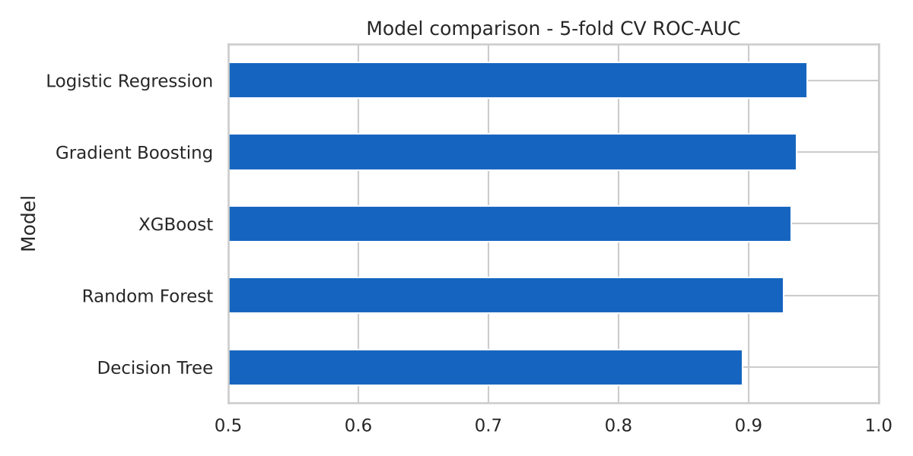
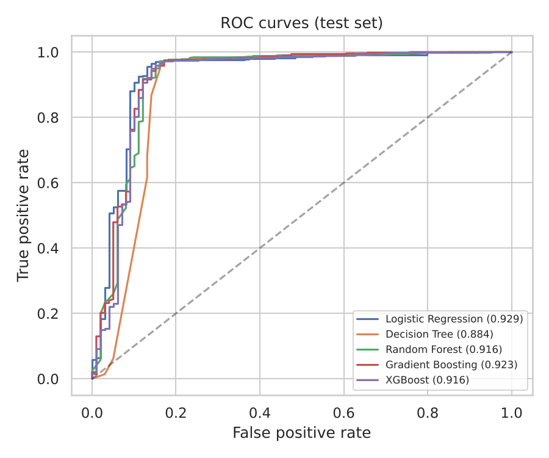
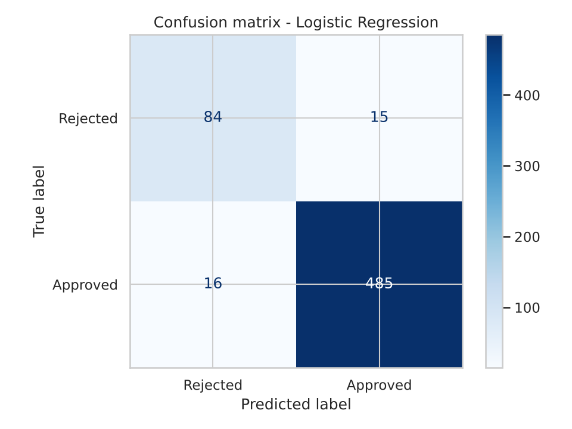
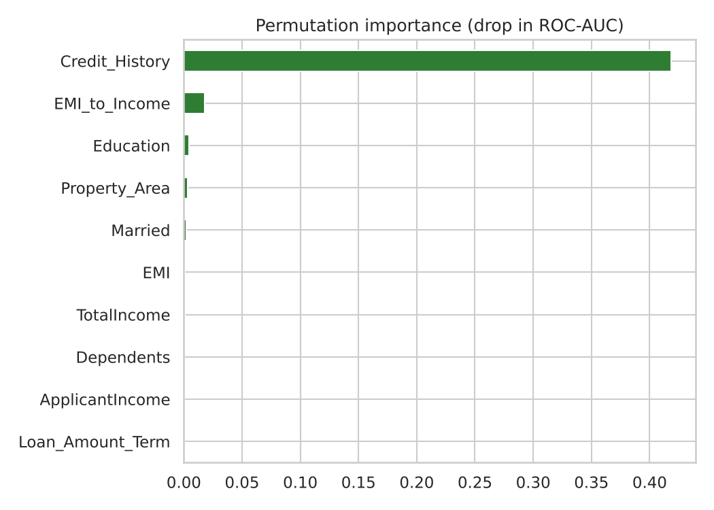

# 🏦 Loan Approval Prediction using Machine Learning

**B.Tech CSE (AI & ML) - Final Year Project**
**Author:** YOUR NAME | **College:** YOUR COLLEGE | **Guide:** GUIDE NAME | **Year:** 2026

An end-to-end machine learning project that predicts whether a loan application
will be approved, from applicant, financial and loan details. It includes a full
training pipeline, model comparison, explainability, and two demos.

**Live demo (browser):** `https://YOUR-USERNAME.github.io/loan-approval-prediction/`
*(turn on GitHub Pages: Settings > Pages > Branch: main, Folder: /docs)*

## Highlights
- Compares 5 models (Logistic Regression, Decision Tree, Random Forest, Gradient Boosting, XGBoost) with 5-fold stratified cross-validation
- Engineered features: total income, EMI, EMI-to-income ratio, log transforms
- Leak-free preprocessing: imputation, scaling and encoding all live inside one scikit-learn `Pipeline`
- Hyper-parameter tuning with `GridSearchCV`, final scores on an untouched 20% test set
- Explainability with permutation importance
- Streamlit web app plus a static browser demo (`docs/`)

## Results
| Metric | Score |
|---|---|
| Accuracy | 0.948 |
| Precision | 0.970 |
| Recall | 0.968 |
| F1 | 0.969 |
| ROC-AUC | 0.929 |

> These numbers are from the bundled **synthetic** dataset. Replace them with your
> real-data results after re-running `python src/train.py` on the real dataset
> (see below). Real-data accuracy is typically around 78-85%.

| Model comparison | ROC curves |
|---|---|
|  |  |

| Confusion matrix | Feature importance |
|---|---|
|  |  |

## Project structure
```
.
├── app.py                    Streamlit web app
├── src/
│   ├── generate_data.py      builds the synthetic dataset
│   └── train.py              full ML pipeline (EDA, features, CV, tuning, evaluation)
├── data/loan_data.csv        dataset
├── models/loan_model.joblib  trained pipeline
├── reports/                  metrics.json, model_comparison.csv, figures/
├── docs/index.html           static browser demo (GitHub Pages)
├── requirements.txt
└── LICENSE
```

## Getting started
```bash
git clone https://github.com/YOUR-USERNAME/loan-approval-prediction.git
cd loan-approval-prediction
python -m venv .venv && source .venv/bin/activate    # Windows: .venv\Scripts\activate
pip install -r requirements.txt

python src/train.py          # train, evaluate, save model and plots
streamlit run app.py         # launch the web app
```

## Using the real dataset
1. Download the **Loan Prediction Problem Dataset** from Kaggle or Analytics Vidhya (check its license before committing the file).
2. Save it as `data/loan_data.csv` (same column names).
3. Run `python src/train.py`, then update the results table above.

## Methodology
1. **Cleaning:** median imputation for numeric and mode imputation for categorical columns, fitted on training data only
2. **Feature engineering:** `TotalIncome`, `EMI`, `EMI_to_Income`, `LogTotalIncome`, `LogLoanAmount`
3. **Modelling:** 5 classifiers benchmarked with 5-fold CV (ROC-AUC), best one tuned with grid search
4. **Evaluation:** accuracy, precision, recall, F1, ROC-AUC, confusion matrix on the hold-out test set
5. **Explainability:** permutation importance; credit history is the dominant factor

## Limitations and future work
- Trained on a small, synthetic dataset; real lending needs far larger, audited data
- No fairness audit (gender, marital status and similar attributes should be checked for bias before any real use)
- Future work: SHAP explanations, class-imbalance handling (SMOTE), model monitoring, REST API deployment

## Disclaimer
Educational project only. Not for real credit decisions.

## License
MIT, see [LICENSE](LICENSE).
